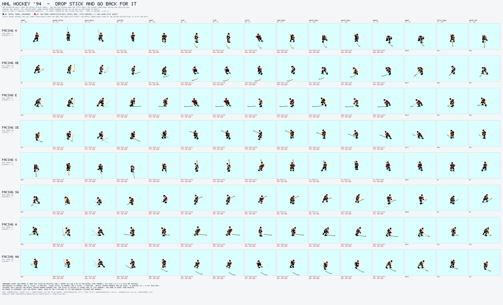

# NHL '94 Genesis: player sprite analysis and a new "drop stick, go back for it" animation



`drop-stick-sheet.png` is the deliverable: the whole action in all eight facings, 15 steps a row, at 2x.
`drop-stick-frames.png` lists every new frame the action needs. The GIFs play each facing at game speed with the camera held still, so you can see the player leave the stick behind and come back for it (`drop-stick-all.gif` plays all eight at once).

Rebuild everything with:

```
node tools/build-dropstick.js [path/to/nhl94.bin] [--team Bruinsv.pal] [--out docs/dropstick]
```

## Which pixels these are

The builder reads the retail **NHL Hockey '94** ROM when there is one in `roms/` (`nhl94.bin`, `.md` or `.gen`), or at the path you give it. It checks the ROM is the retail one (`lib/rom94.js`) and reads the player sheet with the same profile Studio uses (`lib/games.js`).

**The files committed here were built without that ROM.** No NHL '94 ROM was available when they were made, so they come from the NHL 92 `Sprites.anim` bundled in `test/fixtures/ANIM-To-BMP`. That is the sheet NHL '94's player art grew out of, and every frame this animation uses has the same number in both games: `frames94.asm` and `frames.asm` agree on SPFskatewp (1), SPFstop (145), SPFsweep (257) and every other skater group up to SPFfight (354). The two sheets part ways at 371, where '94 inserts SPFfinjury. Every output names its source. If EA retouched any of these frames for '94, run the builder against the '94 ROM to get the exact '94 pixels. The recipe is defined by frame numbers and colour indices, so it applies unchanged.

## 1. How the game stores and draws a skater

### Sheet layout (NHL '94 retail ROM)

| What | Where | Format |
|---|---|---|
| Player sheet | `$5DE7A` | header, then the tile bank from `+$0A`; the long at `+4` points to the frame table |
| Tiles | tile bank | 8x8 pixels, 4 bits per pixel, 32 bytes, high nibble first. Inside one hardware sprite, tiles go column by column |
| Frame table | sheet + long at `+4` | a word offset per frame. Frame *n*'s records run from entry *n* up to entry *n+1*. Each record is 8 bytes |
| Sprite record (93/94 layout) | per frame | `X.w, Y.w` (signed offset from the player position), `tile.w`, attribute byte (bit 3 h-flip, bit 4 v-flip, bits 5–6 palette line, bit 7 priority), size byte (low nibble = VDP size index: `(width-1)*4 + (height-1)` in tiles) |
| HotList | `$A44C8` | a pair of signed bytes per frame, indexed by frame×2: where the puck sits. On a skater it is the **stick blade** |
| Palettes | `$59924` | four lines of 16 Genesis CRAM words (`0000 BBB0 GGG0 RRR0`) |

### What a skater frame is made of (all 352 skater frames, SPFskatewp to SPFHold)

- **1–8 hardware sprites, 7–20 tiles** (average 3.5 sprites and 11 tiles). Sprite sizes run from 1x1 to 4x4 tiles. 2x4, 1x2 and 2x1 are the most common, plus many 1x1 sprites for stray pixels like the stick tip or a skate edge.
- **At most 4 sprites cross any scanline**, far inside the VDP's limit of 20 per line in H40 mode. The bounding box tops out at 70x72 pixels.
- **One palette line per skater.** 1,188 of 1,215 sprites use line 2. Only the ice spray of the SPFstop frames uses line 0 (26 sprites), plus a single sprite on line 1.
- **No priority bit, and almost no flipping.** 11 tiny sprites are h-flipped and one is v-flipped. Each facing is a separate drawing, because players hold the stick on one side, so a mirror image would switch their hand.
- **Tiles are almost never shared**: the 352 frames use 3,774 distinct tiles and only 107 appear in more than one frame. In effect every frame carries its own tiles.

### Palette line 2: what each colour index means

Found by comparing every team palette in `data/pals/genesis`: an index that changes from team to team is jersey, one that never changes is fixed art.

| Index | Use | Same for every team? |
|---|---|---|
| 0 | transparent | — |
| 1 | skate-blade steel, dark highlight (36,36,36) | yes |
| 2 | black: skates, gloves, outline darks | yes |
| 3, 4, 5 | pants: dark, mid, light | team |
| 6, 7 | skin: light, shade | yes |
| 8, 9 | stripes / trim | team |
| 10–13 | jersey, sleeves and helmet, four tones | team |
| **14** | **stick wood** (219,146,73) | **yes** |
| **15** | **ice shadow** (73,146,182) | **yes** |

Because 14 and 15 are fixed, they identify the stick and its shadow on any team. The stick-removal pass relies on that.

### Facings, groups and timing

- **8 facings**, 0 = north on a vertical rink (`dirtab` in `logic.asm`), then clockwise. A horizontal rink subtracts 2 before the lookup.
- An **SPF group** keeps all of a facing's frames together: SPFskatewp is 5 frames per facing (frame +0 is the glide pose used by SPAglide, +1..+4 the stride SPAskatewp cycles), SPFskate 5, SPFstop 2, SPFsweep 2, SPFduck and SPFHold 1.
- An **SPA table** has 8 word offsets (one per facing), a flags word (bit 0 = loop), then `frame,time` pairs per facing, where a negative time marks the last step. `updateanim` shows a step of N vblanks for N+1, and refuses a new picture until 4 vblanks after the last change. Retail steps: skating 10, stop 4, sweep check 4 / 8.
- **Two anchors per frame**: the player position, where the skates meet the ice (sprite X/Y are relative to it), and the hotspot (blade / puck).

### How the pixels are drawn

- **No outline.** Shapes are built from 2–4 tones of each material, and black (2) only appears where the art is black (skates, gloves, dark folds).
- **Proportions**: a standing skater is 16–24 px wide and 28–32 px tall including skates. The helmet and head are about 6 px. Skates are 4–5 px black runs with a steel (1) row under them.
- **The stick is a 1-pixel line of colour 14**, stepped like a Bresenham line and never anti-aliased. It runs from the gloves to a **blade**: a run of colour 14 two pixels thick and about 5–8 long, lying on the ice.
- **Shadows are colour 15 on the ice**: a ragged patch under the skates, **solid under the blade**, and **dotted (every other pixel) under a raised shaft**, one row below the blade along the stick's footprint. A stick lying flat (the dropped sticks of SPFgloves, frame 353) has a shadow pixel under every wood pixel.
- **Ice spray** (SPFstop) is white and light cyan on palette line 0.

## 2. The new action

**Story.** While skating in facing *d*, the blade catches the ice. The shaft pole-vaults over the heel: it stands up, falls forward, and lands flat with the butt end ahead and the blade behind. The player skates on, empty-handed, over the stick, scrape-stops just past it, and pivots through *d+2* to face *r = d+4*. He skates back, bends to the butt end, grabs it, and skates off with the stick on the ice.

The stick landing butt-first is what makes the retail art do the pick-up. In the **SPFsweep** pose of facing *r* the hands are at the butt and the blade lies ahead on the ice, which is exactly how the dropped stick is lying. Standing that pose so its blade (hotspot) sits on the stick's heel puts the gloves on the butt. The "grab" step is the retail frame, unchanged.

| # | Step | Player picture | Stick object | Vblanks |
|---|---|---|---|---|
| 1 | carry | retail SPFskatewp+5d+1 | (in hands) | 10 |
| 2 | blade catches | **new**: SPFskatewp+5d+2 minus stick | standing on its blade (100°) | 6 |
| 3 | pole-vault | **new**: +3 minus stick | falling (145°) | 6 |
| 4 | clatter | **new**: +4 minus stick | flat (180°) | 8 |
| 5 | coast | **new**: glide pose minus stick | flat | 10 |
| 6–7 | stop | **new**: SPFstop+2d, +1 minus stick | flat | 4, 4 |
| 8 | pivot | **new**: SPFstop+2(d+2) minus stick | flat | 6 |
| 9 | turn back | **new**: SPFskatewp+5r minus stick | flat | 6 |
| 10–11 | skate back | **new**: SPFskatewp+5r+1, +2 minus stick | flat | 10, 10 |
| 12 | reach | **new**: SPFsweep+2r minus stick | flat, under the gloves | 6 |
| 13 | grab | retail SPFsweep+2r | (in hands) | 8 |
| 14 | stick down | retail SPFskatewp+5r | (in hands) | 10 |
| 15 | skate off | retail SPFskatewp+5r+1 | (in hands) | 10 |

### New frames: 88

- **SPFnostick**, 64 frames (8 per facing: glide, stride 1–4, stop 1–2, reach). Each is the retail frame with its stick taken out (`tools/dropstick/unstick.js`). Every colour-14 pixel goes. Where the shaft crossed the body, the hole takes the body colour on both sides of it, the way the artist would have painted the jersey behind it. Shadow that only the stick cast goes too. Nothing is added: every pixel left is a retail pixel or a copy of its neighbour. These also give the game a stickless skate, glide and stop (SPAskatenostick, SPAglidenostick, SPAstopnostick) for any future action where the stick is gone: fights, a broken stick, a lost glove.
- **SPFloosestick**, 24 frames (3 per facing). These draw the dropped stick as its own object, the way the puck is one. Its origin is the blade heel, and it is sorted by y against the players like every other sprite. They are drawn only with colours 14 and 15, following the rules above (`tools/dropstick/stick.js`): a 1-pixel stepped shaft, a 2-pixel-thick blade on the ice, a dotted footprint shadow while the shaft is up, and a solid shadow under it once it lies flat. Upright it is 24 px tall, a little under the skater. Lying flat it is as long as the reach from the sweep pose's blade back toward the skates (up to 22 px, about the dropped sticks of frame 353).

### Hardware fit

Every new frame is cut into VDP sprites (`tools/dropstick/pieces.js`, written to `dropstick.json` as size index, offsets, palette line and 4bpp tiles):

| | Frames | Tiles (min–max, avg) | Sprites (max) |
|---|---|---|---|
| Retail skater frames | 352 | 7–20, 11.0 | 8 |
| New stickless bodies | 64 | 6–11, 8.5 | 5 |
| New loose stick | 24 | 3–6, 4.3 | 3 |

No body needs more tiles than the retail frame it came from. All pixels stay on palette line 2, except the retail ice spray, which stays on line 0. The builder refuses to write output if any new frame uses a colour no retail skater frame uses, or goes over the retail limits. Whenever the stick is on screen as an object, the player and the stick together use at most 7 sprites and 16 tiles, inside what one retail skater frame alone may use.

### Into the game

`dropstick94.asm` has the SPF equates and SPA tables in the `frames94.asm` layout: **SPAdropstick**, **SPAstickfall** (on the stick object), **SPAstopnostick**, **SPAskatenostick**, **SPAglidenostick** and **SPAgetstick**. `SPFnew` stands for the first free frame number after the retail sheet. Putting the action in a game also needs code that is not here: logic that triggers the drop, a stick object spawned at the blade's position (the carry frame's hotspot), and logic that steers the player back to stand where the sweep pose's blade lands on the stick's heel (`rows[].grabAt` in `dropstick.json`, relative to where he dropped it). Then it frees the object. The step positions in `dropstick.json` are the sheet's suggested travel. They have not been tuned against the game's skating physics.

## 3. Building other new actions the same way (fights, grabs, tussles)

The recipe generalises:

1. **Start from retail frames.** Bodies come from the 8-facing groups that already exist, so proportions, shading and handedness stay right. SPFfight / SPFfinjury, SPFHold (one arm raised, the other grabbing), SPFhook, SPFstumble and the check groups are the natural sources for a grappling or tussling action.
2. **Remove things by colour index.** Fixed-meaning indices (stick 14, shadow 15, skin 6–7, black 2, steel 1) let a tool find a part on any jersey. Close the holes with the body colour on both sides.
3. **Draw new loose parts with the art's own rules**, using only indices the retail frames use: 1-pixel stepped lines, 2-pixel blades, colour-15 shadows (solid on the ice, dotted under raised parts).
4. **Make separable things separate objects** (stick, gloves, a second player), each anchored at its contact point and y-sorted. For two players locked together, pair each facing *d* with the opponent's *d+4*, as the retail fights do, and let the hotspot carry the contact point (a grabbed jersey, a held stick).
5. **Check the hardware before committing**: one palette line, ≤ 8 sprites and ≤ 20 tiles a frame, and a glance at sprites per scanline when two players overlap.

## Files

| File | |
|---|---|
| `drop-stick-sheet.png` | the character sheet (8 facings × 15 steps, 2x) |
| `drop-stick-frames.png` | the 88 new frames by facing, with tile / sprite counts (3x) |
| `drop-stick-<n,ne,e,se,s,sw,w,nw>.gif`, `drop-stick-all.gif` | each facing played at game speed, camera still |
| `frames/*.png` | each new frame at 1x, 8-bit, the game's colour indices and the 64-colour palette (line 2 = the team) |
| `dropstick94.asm` | SPF equates and SPA tables for `frames94.asm` |
| `dropstick.json` | hardware sprites and tiles of every new frame, step positions and timing |
| `tools/build-dropstick.js`, `tools/dropstick/` | the builder; `test/dropstick.js` checks it |
