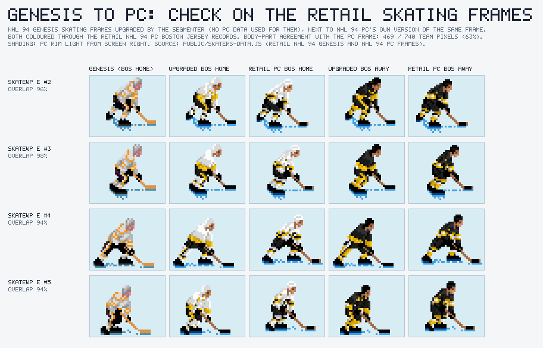

# Genesis fight and injury sprites at the NHL 94 / 95 PC colour standard

Targets:

- **NHLPA Hockey '93 (Genesis)**: the fight frames — gloves 353, fight 354–370, bloody fight injury 371–376 — and the bloody check injury 633–644.
- **NHL Hockey '94 (Genesis)**: the injury frames — fight injury 371–376 and check injury 641–652 (8 frames later than in '93 because SPFgready grew). The builder compares each one with NHLPA '93's same picture and marks the ones whose pixels differ as '94's own.

No NHL 92 data is read anywhere in this tool.

## Status

**The Genesis frames are not in this repository.** They only exist in the two ROMs, which have not been available to the build yet. `report.json` lists what is still missing. What is here:

- [`PC-PALETTE.md`](PC-PALETTE.md): the PC palette structure, colour depth and shading, measured from the retail data in the repo;
- the converter, `tools/build-pc-upgrade.js` with `tools/pcupgrade/`;
- `validation-skating.png`: the converter checked against retail NHL 94 PC art.

Run it with the files in place:

```
node tools/build-pc-upgrade.js --rom93 <NHLPA 93 ROM or folder> --rom94 <NHL 94 ROM or folder> [--pc <NHL 94 PC or 95 PC folder>]
```

Defaults: ROMs in `roms/` (any name; each is checked against the retail checksums) and the PC folder in `pc94/` or `pc95/`. Other options: `--teams bos,mtl,chi`, `--shade pc|genesis`, `--out`.

## Method

1. **Every Genesis pixel stays where it is.** Only its colour index is replaced, by a PC sprite index.
2. **Fixed materials map one to one**, as measured on the aligned retail frames:

   | Genesis | PC sprite index |
   |---|---|
   | steel | 8 |
   | black | 0 |
   | skin | 134 / 136 |
   | eye | 140 |
   | stick | 136 (its blade tape → 0) |
   | shadow | 88 |
   | other lines (e.g. blood) | nearest fixed PC colour, 0–127 |
3. **Team colours get a jersey zone and a shade.** The Genesis team colours are shared tones used across the whole body, but the PC zones are body parts.
   - **Check injury (where the PC sheet has the picture):** NHL 94 PC and 95 PC have it as frames 633–644. The PC frame is aligned with the Genesis one and each Genesis pixel takes the PC zone at its spot, when that PC pixel is the same material (`tools/pcupgrade/transfer.js`).
   - **Everything else is segmented from the Genesis art** (`tools/pcupgrade/segment.js`). The body axis runs from the skates to the face. Height along that axis separates socks, pants, waist, jersey, yoke and helmet, using proportions measured on the PC frames. Bones from the shoulder to each glove or bare fist mark the arms. Trim bands along an arm, the yoke or the waist become stripes 3, 2, 1 counting out from the hand, neck or pants.
4. **Shading.** `--shade pc` (default) re-shades each part the way the PC artists did: light on the edge facing the light, dark on the edge away from it, medium between. That pattern fits 51% of retail PC shades, against 42% for the Genesis tones (chance is 33%). `--shade genesis` keeps the Genesis tones (12/9/5 light, 11/10/4 medium, 13/8/3 dark).
5. **Colour** comes from the retail HOMEPALS / AWAYPALS records: 6-bit VGA, the team's own stripe, yoke, helmet and sock colours. The records are taken from the PC folder, or the bundled NHL 94 PC files without one. Each frame is also written as an 8-bit PNG in PC sprite colour space (255 transparent), ready for a PC sheet.

## Validation



The four retail NHL 94 Genesis skating frames were upgraded by the segmenter alone, with no PC data, and compared with NHL 94 PC's own versions:

- The drawings line up at 94–98% silhouette overlap.
- **63% of team pixels land in the same body part as the PC artist's**: 469 of 740.
- Stick, blade tape, skin, skates and shadow match by construction.
- `test/pcupgrade.js` keeps this from regressing, and checks that no pixel moves.

Expect the segmenter to do worse on fight and lying poses than on these upright frames. The check injury does not depend on it, because it is transferred from the PC frames. With the PC folder connected, those 12 frames also give a second, harder check of the segmenter: lying poses with PC ground truth.
