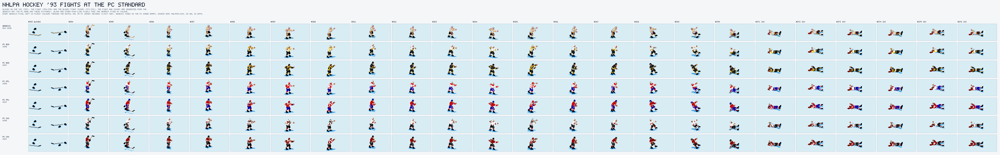
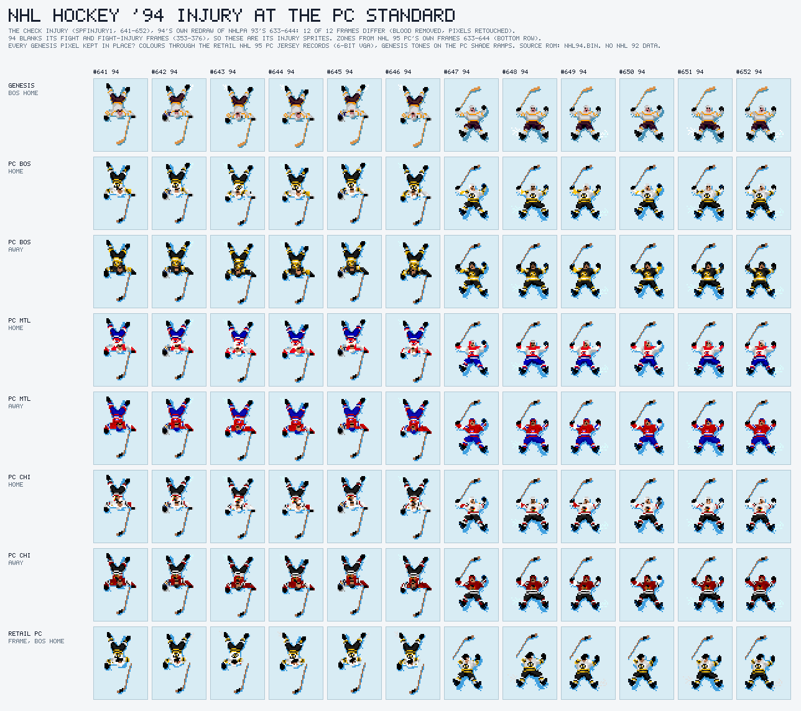

# Genesis fight and injury sprites at the NHL 94 / 95 PC colour standard





| File | What it holds |
|---|---|
| `nhlpa93-fight-sheet.png` | **NHLPA Hockey '93's fighting sprites**: gloves on the ice (353), the fight (354–370) and the bloody fight injury (371–376). One column per frame; the rows are the Genesis original, then the PC-standard upgrade through six retail PC jerseys (Boston, Montreal, Chicago, home and away). |
| `nhl94-injury-sheet.png` | **NHL Hockey '94's injury sprites**: the check injury (641–652), with the same rows plus NHL 95 PC's own version of each frame at the bottom for comparison. |
| `nhlpa93-fight/`, `nhl94-injury/` | Every upgraded frame for each of those jerseys: an 8-bit PNG in **PC sprite colour space** (the pixel values a PC sheet stores, 255 transparent), with that jersey's 256-colour palette. |
| `report.json` | Sources, how each frame was done, and the '93 / '94 comparison. |
| `PC-PALETTE.md` | The PC palette structure, colour depth and shading, measured. |
| `validation-skating.png` | The method on four retail skating frames next to NHL 94 PC's own versions. |

No NHL 92 data is read anywhere. Sources:

- the retail NHLPA '93 (Rev 0) and NHL '94 Genesis ROMs;
- the NHL 95 PC CD: player sheets `000_049.PPV` and the rest, plus `HOMEPALS.BIN` / `AWAYPALS.BIN`.

These go in `roms/` and `pc95/`, both git-ignored.

## What "NHL '94's injury sprites" are

- **No fight frames.** NHL '94 keeps the slots for the gloves, the fight and the fight injury (353–376) but blanks every one to a single pixel.
- **The check injury is '94's own art.** These 12 frames (SPFinjury1) are redrawn from NHLPA '93's 633–644:
  - all 12 differ, by 61–124 pixels each;
  - the blood is gone: '93 has 13–52 red pixels a frame, '94 none, except two orange-brown pixels in 642 and 645.

  `report.json` has the per-frame counts.

## How a Genesis frame is upgraded

1. **No pixel moves.** Only its colour index is replaced, by a PC sprite index.
2. **Fixed materials** map one to one, as measured on the aligned retail frames:

   | Genesis | PC sprite index |
   |---|---|
   | steel | 8 |
   | black | 0 |
   | skin | 134 / 136 |
   | eye | 140 |
   | stick | 136, with the blade tape → 0 |
   | ice shadow | 88 |
   | blood and other rink-line pixels | the nearest fixed PC colour (0–127) |
3. **Team colours get a jersey zone** (one of the PC's 48: helmet, yoke bands, sleeve stripes, forearm, waist bands, pants and their stripes, socks and their stripes):
   - **NHL '94 check injury:** copied from NHL 95 PC's own frames 633–644 after aligning them (`tools/pcupgrade/transfer.js`). The PC frames line up at 88–93% overlap, and 94% of team pixels take the PC artist's zone and shade directly, team crest included. The rest take the model's answer.
   - **NHLPA '93 fights:** no PC game has these pictures, so the zone comes from a model (`tools/pcupgrade/model.json`).
     - **Inputs:** the segmenter's per-pixel geometry (`tools/pcupgrade/segment.js`): height along the skates-to-face axis, side of the spine, distance travelled from the hands, skates, face and pants, distance to the shoulder-to-hand bones, and the Genesis colour class and tone.
     - **Model:** two decision trees, trained on all 345 retail NHL '94 Genesis / NHL 95 PC frame pairs (`export-features.js` then `train_model.py`).
     - **Clean-up:** a majority filter removes single-pixel specks.
4. **Shade:** the Genesis artist's own tone goes onto the PC's three-shade ramp: 12/9/5 light, 11/10/4 medium, 13/8/3 dark. `--shade model` uses the learned shade instead.
5. **Colour** comes from the retail HOMEPALS / AWAYPALS records: 6-bit VGA, each team's own stripe, yoke, helmet and sock colours.

## How well it matches the PC artists

Scored against the PC artist's own frames, team pixel by team pixel:

| Test | Body part | Exact zone | Shade (where the zone is right) |
|---|---|---|---|
| Held-out frames (4 folds of 16-frame blocks) | 78% | 59% | — |
| **Unseen pose types:** model trained without the falls and injuries, scored on them | **76%** | **57%** | 50% with Genesis tones (48.5% learned, 40% always-medium) |
| Hand rules alone, same unseen poses | 57% | 38% | — |

- **The fight frames are the "unseen pose types" case.** Expect about three in four team pixels in the body part the PC artist would choose, and about half in the exact stripe or band.
- **The PC artists shaded by hand** with no consistent light direction. No rule recovers their shades much better than chance, so keeping the Genesis shading is both the most faithful to the source and the best predictor available.
- **The check injury doesn't rely on the model.** It carries the PC artist's own zones.

## Rebuild

```
node tools/build-pc-upgrade.js --pc pc95 [--rom93 …] [--rom94 …] [--teams bos,mtl,chi] [--shade genesis|model]
node tools/pcupgrade/export-features.js --pc pc95 > features.json      # retrain the model (needs scikit-learn)
python3 tools/pcupgrade/train_model.py features.json tools/pcupgrade/model.json
```

The ROMs are looked for in `roms/` (any file name; each is checked against the retail checksums), and the PC folder in `pc94/` or `pc95/`. `test/pcupgrade.js` checks:

- that no pixel moves and the fixed materials map one to one;
- the body-part scores on the skating frames;
- with the ROM and the PC files present, the check-injury transfer.
