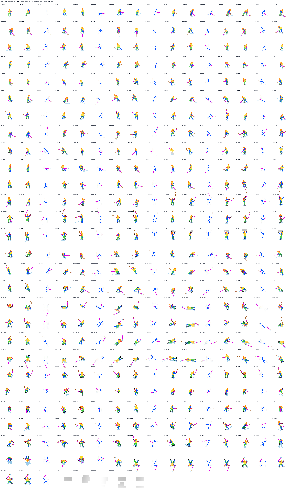
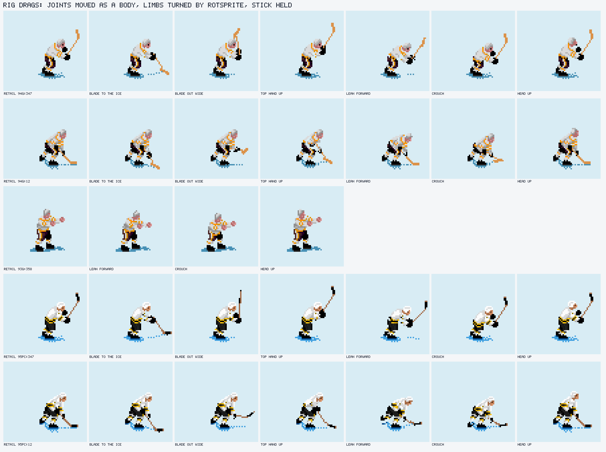
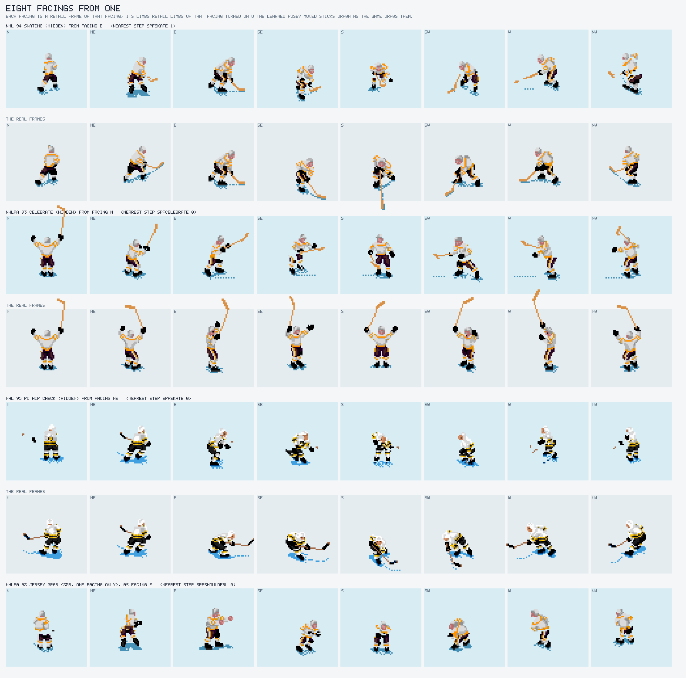

# Skater sprite library: poses and parts from every frame

A pose and part library for building new animations (grabs, tussles, anything) out of the retail art, without redrawing a pixel.

It covers **every skater frame** of three game years: 1,511 frames in 40 animation groups.

| Source | Frames | Body-part labels from |
|---|---|---|
| NHL '94 Genesis (retail ROM) | 440 | NHL 95 PC's own version of the same frame (416), the zone model (24) |
| NHLPA '93 Genesis (retail Rev 0) | 459 | 394 are identical to '94's frame (`sameAs`) and share its labels; the 65 that differ use NHL 95 PC (40) or the zone model (25): the fight, the fight injury |
| NHL 95 PC (CD) | 612 | its own pixels, which *are* zone labels |

- **What 95 PC adds:** animations the Genesis never had — cross-checks (16 frames), board checks (70), bench checks (11), shot blocks (56), face-offs, anthem, line changes and the Cup.
- **What's left out:** goalies, referees and UI.
- **No NHL 92 data is read.**
- **Props:** 12 frames are props rather than skaters (the dropped gloves and sticks, glass panels) and are marked as such.
- **Pose search skips duplicates:** it leaves out NHLPA '93's `sameAs` frames unless asked (`open(dir, { duplicates: true })`).

## What every frame gets



- **A body part for every pixel:**
  - head (helmet and face) and torso (jersey, yoke, waist, crest);
  - `arm0`/`arm1` and `hand0`/`hand1` (glove or bare fist);
  - `leg0`/`leg1` (pants and sock) and `skate0`/`skate1`;
  - stick (shaft and taped blade), shadow, other.

  Arms and legs are split by the hand or skate they lead to, and numbered left to right on screen.
- **A skeleton** in player-position coordinates (the point where the skates meet the ice, the game's own origin):
  - head and neck;
  - shoulder, elbow and hand for each arm;
  - hip, knee and skate for each leg;
  - hip midpoint;
  - stick butt and blade.

  A joint is left empty when it isn't visible: a hand behind the body, no stick in a fight.
- **The animation it belongs to:** source, frame number, SPF group, facing (0 north, clockwise, for the 8-facing groups) and step.

Coverage over the 1,499 skater frames:

| Point | Frames that have it |
|---|---|
| head | 1,492 |
| a skate | 1,491 |
| a hand | 1,321 |
| both hands | 840 |
| a stick | 1,335 |

Missing points are mostly genuinely hidden: a hand behind the back, no stick while fighting or holding the Cup. `overview-94g.png`, `overview-93g.png` and `overview-95pc.png` show every frame with its parts and skeleton drawn in.

### How the labels were made

- **Body zones:**
  - **NHL 95 PC frames** are exact: the PC artists painted every pixel with its zone.
  - **Genesis frames that have a PC counterpart** take the zones copied across (`tools/pcupgrade/transfer.js`).
  - **The 49 Genesis frames with no PC version** — chiefly NHLPA '93's fight — use the zone model from `docs/genesis-to-pc` (76% of body parts right on poses it never saw). On those frames:
    - the face comes from the eye NHLPA '93 draws (index 140), so a raised bare fist isn't mistaken for a head;
    - each arm is traced as the corridor of jersey pixels on a near-shortest path from the hand to the neck.
- **Parts and joints** (`tools/sprites/anatomy.js`):
  - **Black pieces:** black with ice shadow or blade-blue under it, or touching a sock, is a skate; black touching an arm, the body or the stick shaft is a glove; black on the stick end is blade tape.
  - **Limbs** are grown from their hand or skate.
  - **Joints** sit where parts meet: the shoulder where the arm meets the torso, the knee where sock meets pants.

## Finding poses


`tools/sprites/pose.js` scales every skeleton to a standard height, centred on the hips, and finds the nearest poses. Mirrored frames are included if asked, since the Genesis can flip a sprite in hardware. The demo finds structural matches across games and animations. For example, 95 PC's two-handed cross-check matches shot blocks, swings, stumbles and NHLPA '93's fight stances.

```js
const P = require('./tools/sprites/pose');
const lib = P.open('library');
lib.nearest(lib.frame('95pc:889'), { k: 6, mirror: true });            // poses like a cross-check
lib.nearest({ keypoints: { head: [8, -24], hand0: [16, -18], /* ... */ } }, { facing: 2, groups: ['SPFHold'] });
```

## Building new frames


`tools/sprites/compose.js` assembles frames from parts:

- Each layer names a frame and the parts it contributes. It's placed by an anchor: one of its joints moved onto a point, or onto another frame's joint. Layers can be mirrored like the hardware flip.
- Pixels are copied, never redrawn, scaled or rotated (the rig below turns limbs; the composer only places them).
- Output in **native** colours (the Genesis palette lines, when all parts come from Genesis frames) or **PC zones**, which mixes Genesis and PC parts and colours each player with any PC jersey.

The demo makes two frames that exist in no game:

- **Stance + punching arm:** NHLPA '93's fight stance throwing frame 360's raised punch, joined at the shoulder.
- **Jersey grab:** the grab frame with its fist on the chest of a mirrored opponent, Boston against Montreal, placed by the skeletons. This is the kind of building block the tussle animations need.

```js
const C = require('./tools/sprites/compose');
const lib = C.source(require('./tools/sprites/frames').loadAll());
const cel = C.compose([
  { id: '93g:362', flip: true, anchor: ['neck', [0, 0]] },                                   // opponent, mirrored
  { id: '93g:358', anchor: ['hand0', { id: '93g:362', joint: 'neck', flip: true }], nudge: [-1, 4] }  // fist on his chest
], lib, { space: 'zones' });                                                                  // cel.px, cel.owner per pixel
```

## Layers for each game year

`node tools/build-sprite-layers.js` writes every frame of each year as an **OpenRaster** file, which GIMP, Krita and MyPaint open as layers:

- `library/layers/93g/` — NHLPA Hockey '93 (Genesis);
- `library/layers/94g/` — NHL Hockey '94 (Genesis);
- `library/layers/95pc/` — NHL Hockey 95 (PC).

Each part is its own layer, at its place, in that year's colours. From bottom to top:

1. shadow
2. stick shadow
3. far leg and skate
4. near leg and skate
5. far arm and hand
6. torso
7. head
8. stick
9. near arm and hand

A hidden "skeleton" layer sits on top. Of each pair of limbs, the one hanging from the joint lower on screen is the near one, as in the game's top-down view. The stick's shadow is split from the body's (shadow more than 3 pixels from the legs belongs to the stick), so it moves with the stick. The layers of every frame rebuild it exactly; `test/spritelib.js` checks all 1,511.

## The rig and eight facings from one

`lib/sprite-rig.js` runs the same way in Node and in the browser, with `lib/pixel-art.js` for the pixel work. It moves a skeleton the way a body moves, then draws the pose from the game's own art.



- **Moves joints as a body** (`drag`). Bone lengths, reach and grip are measured from the pose when a drag starts:

  | Drag | What follows |
  |---|---|
  | hand, skate | reaches there by two-bone IK at the arm's or leg's own lengths; the elbow or knee bends on its side |
  | elbow, knee | changes the bend; a hand on the stick and a skate on the ice stay put |
  | shoulder | leans the upper body about the hips, up to about 35°; head, arms and a held stick go with it |
  | hip | moves the body; the skates stay planted and the knees bend, as far as the legs reach |
  | head | turns on the neck, up to about 35° from where it started |
  | stick blade | swings the stick about the top hand, at a length the game's own sticks have (foreshortened sticks included) |
  | top hand, stick butt | carries the butt; a blade on the ice stays planted and the shaft slides through the hands |
  | bottom hand | levers the stick about the top hand, sliding along the shaft; hands together at the butt carry it between them |

  The bottom hand follows the shaft after every move, sliding to a grip it can reach. The hands keep their roles from one drag to the next.
- **Draws a pose** (`render`). It starts from a base frame:
  - **Torso and head:** the torso leans about the hips and the head turns on the neck, by RotSprite (below).
  - **Arms:** each moved arm is the retail arm (this game and facing; the base's own first) whose shape best fits once turned. It hangs from the shoulder and is turned bone by bone onto the elbow and hand. A small turn of the right drawing beats a big turn of a near one.
  - **Gloves and skates** are set at the end of the limb unturned: a three-pixel glove turned breaks up.
  - **Legs:** the games often draw both legs as one shape, so the lower body is taken whole from the retail frame whose stance fits. It's set down on the pose's skates. The torso may come down over the top of the legs, the way the games' artists crouch a player a pixel or two, but never leaves a gap above them.
  - **The stick** is drawn the way the game draws one wherever it moved:
    - the shaft is a clean pixel line in the game's own stick colour;
    - the blade is copied from the retail stick nearest in angle (same facing first, and mirrored as the hardware flip would), turned the last few degrees;
    - its shadow is dithered on the ice below it.
  - **Clean-up:** where an arm moves off the chest, the chest is filled in from the torso's own pixels. Lone specks and pinholes the re-assembly leaves are cleaned, only where something moved.
- **Pixel work** (`lib/pixel-art.js`):
  - **RotSprite:** Scale2x three times, rotate at 8x, read back at 1x. It keeps the artist's outlines and shading through a turn, where plain rotation leaves broken, doubled edges.
  - **Clean lines:** a line steps in a repeating pattern (1:0, 5:1, 4:1, 3:1, 2:1, 3:2, 1:1), as a pixel artist draws one.
  - **No new colours:** every pixel written is a value the game already uses. `test/spritelib.js` checks this, along with the drag rules and that a moved stick is drawn in one piece.
- **Works out all eight facings from one.** The games draw 151 animation steps in all eight facings, which is how a pose changes as the player turns. From them it learns, for every pair of facings and every joint, how the joint moves. The pose for each other facing averages that learned turn with the closest three steps' poses in that facing. Each facing is then drawn on the closest step's frame of that facing, with limbs swapped to fit.
  - **Accuracy**, recreating facings of steps it never saw (`tools/sprites/eval-directions.js`): joints land 6.4 pixels from the real frames' on average. The closest step's pose alone lands 6.9 pixels away, and copying the source pose 8.9.
  - **What the error means:** the games' facings are not exact rotations of one pose (each was drawn separately), so expect a few pixels of difference.
  - **Your facing is kept:** the facing you posed is your pose itself.
  - **Sticks:** each facing's stick is put back in the hands: the butt at the top hand and the shaft through the bottom hand, held as that facing's frame holds it. A stick-less pose (a fight) stays stick-less.
  - **Reach:** predicted hands are kept within the arms' reach.
  - **Props:** animations with a prop, the Stanley Cup, are never used.



## The Animator

`public/animator.html` is a Studio page (header button **Animator**, under `node server.js`). It reads `library/bundle-<year>.json` from your own build:

1. Pick the year and a frame.
2. Drag the joints and the body follows, as in the table above. On release, the skeleton snaps to where the drawn limbs put the joints. Under the stage, **Drawn from** lists the retail frames each arm, the legs and the blade came from, and how far each was turned.
3. Hide layers to see behind them.
4. Click any of the eight facings to keep editing in that facing.
5. Add poses to a sequence with a hold in vblanks, and play it in any facing.
6. Export the sequence as an 8-row sprite sheet (PNG), or as JSON: each facing's pixels in the game's own indices, its base frame, the retail limbs it was drawn from, and its skeleton.

A frame the game draws in one facing only (NHLPA '93's fight) is given a facing with **As facing**.

## Files and rebuilding

```
node tools/build-sprite-library.js        # frames, parts, skeletons, overviews (about 10 s)
node tools/build-sprite-layers.js         # layered .ora per year, and the Animator's bundles (about 10 s)
node tools/sprites/demo.js                # demo-retrieval.png, demo-compose.png
node tools/sprites/demo-directions.js     # demo-directions.png
node tools/sprites/demo-rig.js            # demo-rig.png: each drag on retail frames (after build-sprite-layers.js)
node tools/sprites/eval-directions.js     # the eight-facing accuracy check
```

The builder needs the retail NHLPA '93 and NHL '94 Genesis ROMs and the NHL 95 PC CD image in `roms/`. Any file names work: each is found by its contents. The CD image can be an `.iso`, `.img` or `.mdf` (archive.org's `HOCKEYPC.mdf` works as it is). An installed NHL 95 PC folder in `pc95/`, or given with `--pc`, also works.

**`library/`** is git-ignored. It holds the games' art, so it is rebuilt from your own files:

| Path | Contents |
|---|---|
| `frames.json` | every frame: source, group, facing, step, size, origin, keypoints, part counts |
| `frames/<id>.png` | the frame's own pixels, with a palette to view them |
| `parts/<id>.png` | the part map (pixel = part number) |
| `zones/<id>.png` | PC zone indices |
| `cut/<id>/<part>.png` | every part cropped on its own |
| `cut/<id>/parts.json` | each part's box and the joints it carries |
| `layers/<year>/<id>.ora` | each frame as layers (OpenRaster) |
| `bundle-<year>.json` | what the Animator loads |

**This folder** holds only things that aren't the art itself:

- `skeletons.json`: the keypoints and facings;
- `stats.json`;
- the overview and demo images.

`test/spritelib.js` checks the pose maths always. With the files present, it also checks:

- every pixel of every frame gets a part;
- head, hand and skate coverage;
- the composer copies pixels exactly.
