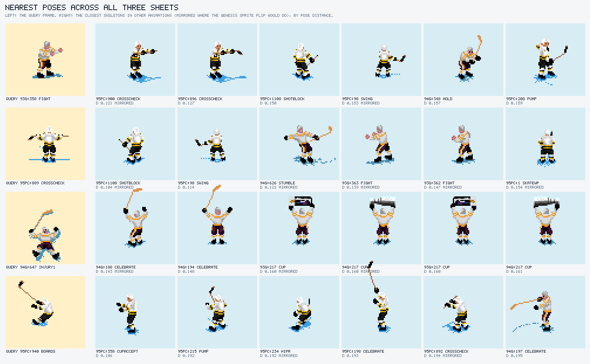
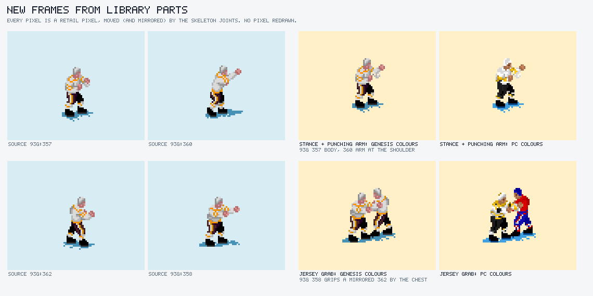

# Skater sprite library: poses and parts from every frame

A pose and part library for building new animations (grabs, tussles, anything) out of the retail art, without redrawing a pixel.

It covers **every skater frame** of three sheets: 1,117 frames in 40 animation groups.

| Source | Frames | Body-part labels from |
|---|---|---|
| NHL '94 Genesis (retail ROM) | 440 | NHL 95 PC's own version of the same frame (416), the zone model (24) |
| NHLPA '93 Genesis (retail Rev 0), only where it differs from '94 | 65 | NHL 95 PC (40), the zone model (25): the fight, the fight injury |
| NHL 95 PC (CD) | 612 | its own pixels, which *are* zone labels |

- **What 95 PC adds:** animations the Genesis never had — cross-checks (16 frames), board checks (70), bench checks (11), shot blocks (56), face-offs, anthem, line changes and the Cup.
- **What's left out:** goalies, referees and UI.
- **No NHL 92 data is read.**
- **Props:** 11 frames are props rather than skaters (the dropped gloves and sticks, glass panels) and are marked as such.

## What every frame gets


- **A body part for every pixel:**
  - head (helmet and face) and torso (jersey, yoke, waist, crest);
  - `arm0`/`arm1` and `hand0`/`hand1` (glove or bare fist);
  - `leg0`/`leg1` (pants and sock) and `skate0`/`skate1`;
  - stick (shaft and taped blade), shadow, other.

  Arms and legs are split by the hand or skate they lead to, and numbered left to right on screen.
- **A skeleton** in player-position coordinates (the point where the skates meet the ice, the game's own origin):
  - head and neck;
  - shoulder, elbow and hand for each arm;
  - hip, knee and skate for each leg;
  - hip midpoint;
  - stick butt and blade.

  A joint is left empty when it isn't visible: a hand behind the body, no stick in a fight.
- **The animation it belongs to:** source, frame number, SPF group, facing (0 north, clockwise, for the 8-facing groups) and step.

Coverage over the 1,106 skater frames:

| Point | Frames that have it |
|---|---|
| head | all |
| neck | 1,099 |
| hip midpoint | 1,100 |
| a skate | 1,100 |
| a hand | 988 |
| both hands | 670 |
| a knee | 1,005 |
| a stick | 949 |

Missing points are mostly genuinely hidden: a hand behind the back, no stick while fighting or holding the Cup. `overview-94g.png`, `overview-93g.png` and `overview-95pc.png` show every frame with its parts and skeleton drawn in.

### How the labels were made

- **Body zones:**
  - **NHL 95 PC frames** are exact: the PC artists painted every pixel with its zone.
  - **Genesis frames that have a PC counterpart** take the zones copied across (`tools/pcupgrade/transfer.js`).
  - **The 49 Genesis frames with no PC version** — chiefly NHLPA '93's fight — use the zone model from `docs/genesis-to-pc` (76% of body parts right on poses it never saw). On those frames:
    - the face comes from the eye NHLPA '93 draws (index 140), so a raised bare fist isn't mistaken for a head;
    - each arm is traced as the corridor of jersey pixels on a near-shortest path from the hand to the neck.
- **Parts and joints** (`tools/sprites/anatomy.js`):
  - **Black pieces:** black with ice shadow or blade-blue under it, or touching a sock, is a skate; black touching an arm, the body or the stick shaft is a glove; black on the stick end is blade tape.
  - **Limbs** are grown from their hand or skate.
  - **Joints** sit where parts meet: the shoulder where the arm meets the torso, the knee where sock meets pants.

## Finding poses



`tools/sprites/pose.js` scales every skeleton to a standard height, centred on the hips, and finds the nearest poses. Mirrored frames are included if asked, since the Genesis can flip a sprite in hardware. The demo finds structural matches across games and animations. For example, 95 PC's two-handed cross-check matches shot blocks, swings, stumbles and NHLPA '93's fight stances.

```js
const P = require('./tools/sprites/pose');
const lib = P.open('library');
lib.nearest(lib.frame('95pc:889'), { k: 6, mirror: true });            // poses like a cross-check
lib.nearest({ keypoints: { head: [8, -24], hand0: [16, -18], /* ... */ } }, { facing: 2, groups: ['SPFHold'] });
```

## Building new frames



`tools/sprites/compose.js` assembles frames from parts:

- Each layer names a frame and the parts it contributes. It's placed by an anchor: one of its joints moved onto a point, or onto another frame's joint. Layers can be mirrored like the hardware flip.
- Pixels are copied, never redrawn, scaled or rotated.
- Output in **native** colours (the Genesis palette lines, when all parts come from Genesis frames) or **PC zones**, which mixes Genesis and PC parts and colours each player with any PC jersey.

The demo makes two frames that exist in no game:

- **Stance + punching arm:** NHLPA '93's fight stance throwing frame 360's raised punch, joined at the shoulder.
- **Jersey grab:** the grab frame with its fist on the chest of a mirrored opponent, Boston against Montreal, placed by the skeletons. This is the kind of building block the tussle animations need.

```js
const C = require('./tools/sprites/compose');
const lib = C.source(require('./tools/sprites/frames').loadAll({ pc: 'pc95' }));
const cel = C.compose([
  { id: '93g:362', flip: true, anchor: ['neck', [0, 0]] },                                   // opponent, mirrored
  { id: '93g:358', anchor: ['hand0', { id: '93g:362', joint: 'neck', flip: true }], nudge: [-1, 4] }  // fist on his chest
], lib, { space: 'zones' });                                                                  // cel.px, cel.owner per pixel
```

## Files and rebuilding

```
node tools/build-sprite-library.js --pc pc95     # about 10 s
node tools/sprites/demo.js --pc pc95
```

The builder needs the retail ROMs in `roms/` and the NHL 95 PC files in `pc95/`.

**`library/`** is git-ignored. It holds the games' art, so it is rebuilt from your own files:

| Path | Contents |
|---|---|
| `frames.json` | every frame: source, group, facing, step, size, origin, keypoints, part counts |
| `frames/<id>.png` | the frame's own pixels, with a palette to view them |
| `parts/<id>.png` | the part map (pixel = part number) |
| `zones/<id>.png` | PC zone indices |
| `cut/<id>/<part>.png` | every part cropped on its own |
| `cut/<id>/parts.json` | each part's box and the joints it carries |

**This folder** holds only things that aren't the art itself:

- `skeletons.json`: the keypoints and facings;
- `stats.json`;
- the overview and demo images.

`test/spritelib.js` checks the pose maths always. With the files present, it also checks:

- every pixel of every frame gets a part;
- head, hand and skate coverage;
- the composer copies pixels exactly.
