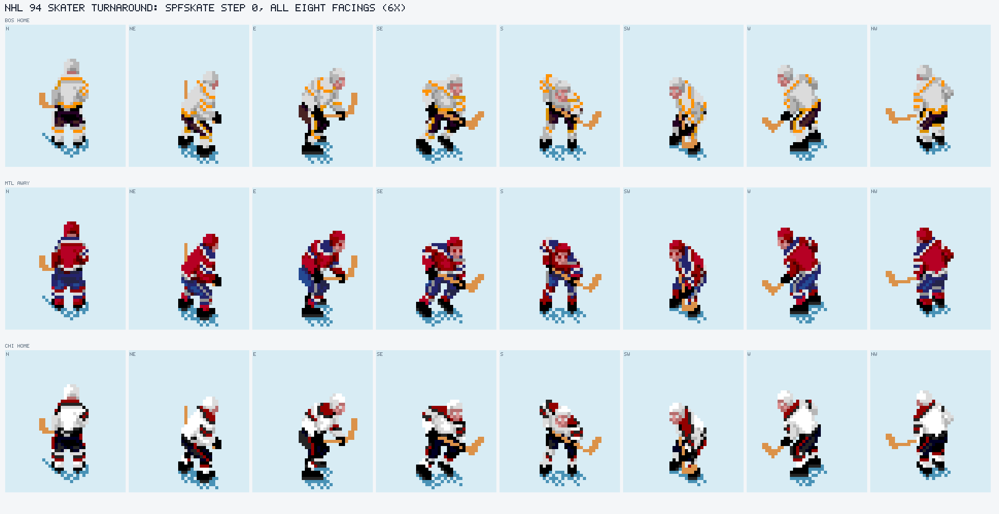

# NHL '94 skater style: the reference sheets

These sheets fix the look of NHL Hockey '94's skaters. Every new or upgraded frame is checked against them. Everything here is measured from the 426 retail skater frames of the NHL '94 Genesis ROM (no NHL 92 data). They're rebuilt from your own ROM in `roms/`:

```
node tools/build-style-sheets.js [--teams bos:home,mtl:away,chi:home] [--out docs/sprite-style/nhl94]
```

| File | Use it for |
|---|---|
| `turnaround.png` / `turnaround-1x.png` | The reference pose (skating, SPFskate step 0) in all eight facings, three teams. The 1x file is the style reference image to give an image tool. |
| `colour-roles.png` | What each of the 15 colours is for, each team's values, and the turnaround painted by colour. |
| `jersey-zones.png` | Where each stripe and band sits in every facing. |
| `helmet.png`, `gloves.png`, `stick.png` | Every distinct helmet, glove and blade the game draws, by facing, most-used first. |
| `proportions.png` | The skeleton of each facing, with its median bone lengths. |
| `style.json` | All of it as numbers, for checking a frame automatically. |



## The rules

**Size.** A skater stands about 23 pixels from helmet to skates (18–19 facing the camera, S and SW, where he leans in). The median frame is 21–29 pixels wide and 30–35 tall; a wide pose (a stick out) reaches 67. A head is 3–4 pixels to the neck, the torso about 10 to the hips, a thigh and a shin about 5 each. Anything "more detailed" at this size has to fit these proportions. The alternative is a deliberate change of scale, and then every frame has to change scale together.

**Colour.** One 16-colour palette line, colour 0 transparent. Line 2 is the team's, loaded from the team list for home or away, so a frame never stores team colours: it stores roles.

| Colour | Role | Share of pixels |
|---|---|---|
| 11 / 12 / 13 | main colour medium / light / dark: jersey, sleeves, helmet | 13.4 / 12.7 / 5.0% |
| 10 | second colour, one tone: stripes, socks | 8.1% |
| 9 / 8 | trim light / dark: stripes, socks | 5.7 / 4.9% |
| 5 / 4 / 3 | pants light / medium / dark | 3.5 / 5.1 / 3.5% |
| 6 / 7 | skin light / shade (face only) | 0.5 / 2.0% |
| 2 | black: skates and gloves | 12.6% |
| 14 | stick (shaft and blade, no tape) | 7.3% |
| 15 / 1 | ice shadow / its dark core, dithered | 14.0 / 1.6% |

About 1% of pixels, small unlabelled details, use the fixed palette lines 0 and 1.

**Shading.** Three tones per team colour, two for the trim, one for the second colour. Light comes from above. On the jersey, the light tone sits up to two pixels above the dark tone in seven facings (in NW about level), and toward the screen's left in N, NE, E and NW. `style.json` has the median per facing.

**No outline.** Only about 18% of silhouette-edge pixels are black, and those are the skates and gloves. The body's edge is drawn in its own colours, the dark tone where it turns away. A black outline around the whole player is the first thing that makes a redraw look like a different game.

**Gloves and skates are solid black blobs.** Gloves are 2–5 pixels across, with no fingers and no highlight. Each facing uses 41–75 different glove shapes, because the artists redrew them per frame.

**Helmet.** A helmet is the main colour (11/12/13); the face is skin (6/7). There are 34–43 distinct helmet shapes per facing.

**Stick.** The shaft is one pixel wide in colour 14, drawn in clean stair-steps. It's 17 pixels long butt to blade (median), 6 to 29 as it foreshortens. The blade is the last 3 pixels, the same colour, and has no tape on the Genesis.

**Ice shadow.** A dithered patch under the skates in colour 15, with a core of colour 1. A lowered stick drops its own shadow.

## Using them with PixelLab (or any generator)

1. **Style reference:** give the generator `turnaround-1x.png`, the row for the team you're drawing, as the style image. Give it the retail frame you're upgrading as the pose reference.
2. **Colours:** lock the palette to the 15 colours of the team's line (`style.json` → `palette.teams`), and map the output back to roles (`colour-roles.png`). A frame that uses colours outside its line can't be loaded by the game, and loses the team colours when the team changes.
3. **Size and proportions:** keep the frame inside the facing's size (`style.json` → `facings.<F>.size`) and the skeleton within a pixel or two of `proportions.png`, unless you're deliberately changing the scale of every frame.
4. **Consistency:** compare each output's stripes with `jersey-zones.png` for its facing, and its helmet, gloves and blade with the shapes on their sheets. Generators draw stripes and bands in slightly different places from frame to frame, and that is what makes an animation flicker.
5. **Check before replacing:** a frame replaces the original only after it passes these checks. The originals stay in the library either way.
